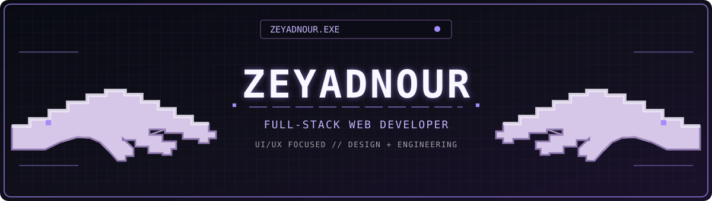
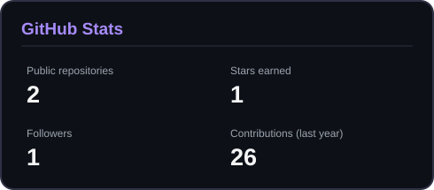
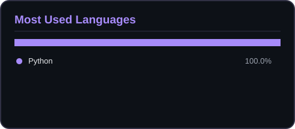

  

  <h1>Hi, I'm Zeyad Nour 👋</h1>
  <strong>Full-Stack Web Developer · UI/UX-Focused · MIS Graduate · Egypt 🇪🇬</strong>
    
  
  
  

---

## 01 / About Me

I'm **Zeyad Nour**, a web developer based in Egypt and a **Management Information Systems graduate from Delta University for Science and Technology, Class of 2026**.

I build web applications with an emphasis on **clean architecture, well-structured interfaces, reliable backend integration, and practical user experiences**.

My work spans planning application structure, implementing responsive interfaces, designing database schemas, integrating authentication and permissions, building admin dashboards, and deploying applications.

For me, development is more than writing code. I start by understanding the requirements, how the different parts of a product should work together, and how to keep the code maintainable as the application evolves.

> Thoughtful design. Structured engineering. Continuous improvement.

## 02 / What I Do

- **Frontend Engineering** — Responsive, accessible, component-based interfaces.
- **Full-Stack Development** — Connecting applications to databases, APIs, and backend services.
- **UI/UX Implementation** — Turning design ideas into consistent, usable experiences.
- **Database & Authentication** — Data models, access policies, and authentication flows.
- **Admin Systems** — Dashboards, management tools, and role-based workflows.
- **Performance & Security** — Validation, error handling, optimization, and secure development practices.

## 03 / Tech Stack

  

| Area | Technologies & Practices |
| :--- | :--- |
| **Frontend & Frameworks** | HTML5 · CSS3 · JavaScript · TypeScript · React · Next.js · Tailwind CSS |
| **Backend & Database** | Node.js · Supabase · PostgreSQL · REST APIs · Supabase Edge Functions |
| **Authentication & Security** | Supabase Auth · OAuth · Row Level Security (RLS) · Role-Based Access Control (RBAC) |
| **Design & Development** | Figma · Git · GitHub · Visual Studio Code · npm |
| **Deployment & Hosting** | Vercel · GitHub · Static Web Hosting |

## 04 / How I Build Projects

I follow a structured workflow that connects design, engineering, testing, and deployment.

| Stage | My Approach |
| :--- | :--- |
| **01 — Planning & Requirements** | Understand the problem, define user roles and core features, and map out the application structure. |
| **02 — UI/UX & Design Systems** | Plan layouts, reusable components, typography, spacing, responsive behavior, and interaction patterns. |
| **03 — Application Architecture** | Organize routes, components, services, and shared logic for maintainability and future changes. |
| **04 — Database & Backend** | Design schemas, relationships, authentication flows, access policies, and API integrations. |
| **05 — Development & Integration** | Build features incrementally and connect interfaces to real application data and services. |
| **06 — Testing & Optimization** | Check functionality, responsiveness, validation, permissions, error handling, and performance. |
| **07 — Deployment & Improvement** | Configure production environments, deploy, review behavior, and refine based on testing and usage. |

## 05 / Education

🎓 **Delta University for Science and Technology**  
Management Information Systems (MIS) · **Class of 2026**

## 06 / Selected Projects

### 🏙️ Ballaghny — Civic Reporting Platform

A web platform designed to organize public issue reporting and complaint management.

- Citizen reporting and complaint-tracking workflows
- Role-based dashboards and complaint management
- Database integration using Supabase

### 🛍️ ZED Shop — Gold E-commerce Website

An e-commerce application focused on gold product discovery and store administration.

- Product listings, details, and pricing information
- Responsive storefront and product browsing experience
- Admin tools for managing products and store content

### 🎮 OverPower — Gaming E-commerce Platform

A gaming-focused e-commerce application combining product discovery and store operations.

- Product browsing and shopping features
- Customer-facing storefront and administrative workflows
- Organized application structure for future development

## 07 / GitHub Stats

  
  

## 08 / Activity Graph

  

## 09 / Connect With Me

I'm interested in building useful products, improving development workflows, and working on projects where design and engineering come together.

  <a href="https://github.com/szmff">GitHub</a> ·
  <a href="https://eg.linkedin.com/in/zeyad-nour-108b86378">LinkedIn</a> ·
  <a href="mailto:zeyadnour68@gmail.com">Email</a>
    
  ZEYADNOUR // Thoughtful design. Structured engineering. Continuous improvement.

